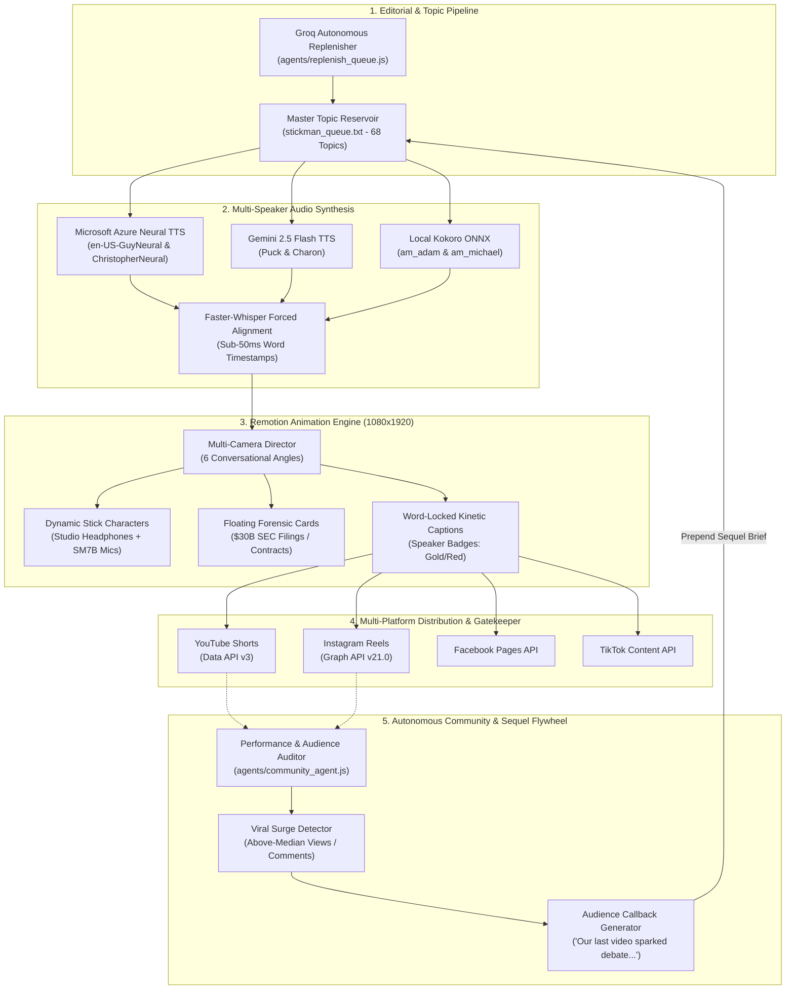

# The Lincoln Penny — Autonomous Media Engine & Stickman Podcast Pipeline

> **"The business story you know. The money story you don't."**  
> An autonomous end-to-end media production, animation, and multi-channel distribution engine for *The Lincoln Penny* (`@thelincolnpenny` / `@lincolnpennystories`).

---

## 🏛️ System Architecture



---

## 📁 Repository Structure

```
.
├── motion-engine/              # Remotion React 1080x1920 video composition engine
│   ├── src/
│   │   ├── StickmanPodcastShort.tsx      # Flagship 2-character animated podcast
│   │   ├── McDonaldsFoundersShort.tsx    # 2.5D documentary archival composition
│   │   ├── SonyForensicTeardownShort.tsx # Hardware teardown forensic short
│   │   ├── Root.tsx                      # Composition catalog & resolution specs
│   │   ├── components/                   # BroadcastGrade, KineticCaptionBar, HUDs
│   │   └── scenes/                       # Scene transition blocks
│   ├── public/                 # Static studio backgrounds, deeds, fonts, audio
│   ├── package.json
│   └── tsconfig.json
├── audio-engine/               # Multi-speaker dual-voice TTS engines
│   ├── edge_podcast_audio.py   # Zero-cost Microsoft Azure Neural TTS (Guy & Christopher)
│   ├── gemini_podcast_audio.py # Google Gemini 2.5 Flash TTS (Puck & Charon)
│   ├── conv_tts.py             # Dual-voice Kokoro ONNX offline synthesis
│   └── tts.py                  # Single-voice narration master
├── agents/                     # Autonomous Cron & Growth Agents
│   ├── community_agent.js      # Community moderation + Viral sequel trigger flywheel
│   ├── replenish_queue.js      # Automated Groq topic reservoir replenisher
│   ├── analytics.js            # Multi-platform growth auditor
│   └── token_refresh.js        # Automated OAuth token rotation
├── distribution/               # Multi-Channel Publishing
│   ├── publish_youtube.js      # Automated YouTube Shorts publisher & metadata tagger
│   ├── publish_instagram.js    # Instagram Reels container publisher
│   ├── publish_facebook.js     # Facebook Video publisher
│   └── publish_tiktok.js       # TikTok video uploader
└── editorial/                  # Editorial Reservoir & Briefs
    ├── stickman_queue.txt      # Active 68-topic corporate secrets backlog
    ├── short_brief_v3.js       # Scriptwriting engine scored against 21 hook formulas
    └── story_lab.js            # Narrative structuring lab
```

---

## 🎙️ Flagship Format: The Stickman Business Podcast

A high-retention conversational Shorts format where two animated stick characters sit at a luxury podcast desk, wearing studio headphones behind Shure SM7B broadcast microphones, exposing dirty corporate business secrets with floating forensic evidence cards.

### Visual & Directorial Features
1. **Multi-Camera Dynamic Switching:**
   - **Host Hook Zoom:** Tight framing on the Host setting up the mystery.
   - **Guest Revelation Push:** Smooth camera push as the Insider delivers the counter-intuitive revelation.
   - **Host Visceral Shock Cut:** Close-up on the Host with dropped jaw, arched eyebrows, and open-mouth reaction.
   - **Cinematic Wide 2-Shot:** Wide table view displaying both characters alongside a floating, gold-bordered forensic document (e.g. *Franchise Realty Corporation \$30 Billion Valuation*).
   - **Closing Loop Outro:** Circular callback to the opening line, optimizing Shorts algorithmic replay loops.
2. **Audio-Reactive Animation:**
   - Mouths dynamically open and articulate synchronously with active speech phonemes.
   - Natural subtle idle breathing and head-tilt rotations prevent characters from looking static.
3. **Word-Locked Kinetic Subtitles:**
   - Speaker-badged pill (`THE HOST` in gold, `THE INSIDER` in red).
   - Word-by-word active glow tracking spoken audio within platform-safe margins.

---

## 🔄 The Autonomous Sequel & Community Flywheel

```
Published Video Hits Virality ──> community_agent.js Audits Views/Comments
                                              │
                                              ▼
                                 Extracts Top Audience Arguments
                                              │
                                              ▼
                                 Synthesizes Callback Hook:
                                 "Our last video about X blew up, and the
                                  comments were fighting over Y... But nobody
                                  knows where the money actually goes."
                                              │
                                              ▼
                                 Prepends Part 2 Sequel to stickman_queue.txt
                                              │
                                              ▼
                                 Pipeline Automatically Renders Next Episode
```

---

## 🚀 Quickstart & Usage

### 1. Motion Engine Setup (Remotion)
```bash
cd motion-engine
npm install

# Preview in interactive Remotion Player
npm start

# Render specific still frame
npx remotion still StickmanPodcastShort preview.png --frame=600

# Render full 1080x1920 broadcast video
npx remotion render StickmanPodcastShort out/podcast-short.mp4 --concurrency=2
```

### 2. Dual-Voice Audio Generation (Edge-TTS)
```bash
# Generate dual-voice track with Microsoft Azure Neural (Guy + Christopher)
python audio-engine/edge_podcast_audio.py
```

### 3. Run Autonomous Community & Sequel Agent
```bash
# Run moderation & audit recent video performance
node agents/community_agent.js --growth-audit

# Replenish topic reservoir with fresh dirty corporate secrets
node agents/replenish_queue.js --min 20 --target 40
```

---

## 📜 License & Attribution
Proprietary & Confidential. Built for **The Lincoln Penny** media network. Powered by Remotion, Microsoft Edge Neural TTS, Google Gemini, and Faster-Whisper.
